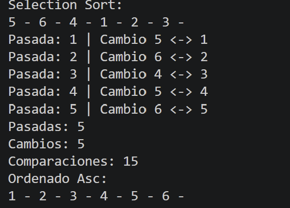

# Selection Sort: contar pasadas, comparaciones y cambios

Agregamos 3 contadores (variables que empiezan en 0 y suben de 1 en 1).

## 1. Crear los contadores

```java
int cambios = 0;
int pasadas = 0;
int comparaciones = 0;
```

Van al inicio del método, antes de los ciclos, para que no se reinicien en cada vuelta.

## 2. Pasadas

```java
for(int i = 0; i < arreglo.length - 1; i++)
{
    pasadas++;
```

Cada vuelta del ciclo de afuera es una pasada, así que sumamos 1 al empezar cada vuelta.


## 3. Cambios

```java
if(min != i)
{
    cambios++;
```

Solo hay un cambio cuando el número menor está en otra posición. Por eso se suma dentro de este `if`.

## 4. Mostrar los resultados

```java
System.out.println("Pasadas: " + pasadas);
System.out.println("Cambios: " + cambios);
System.out.println("Comparaciones: " + comparaciones);
```

Van al final, fuera de los ciclos, para que se impriman una sola vez.

## 5. Captura de pantalla del codigo


## 6. Compilacion del codigo
